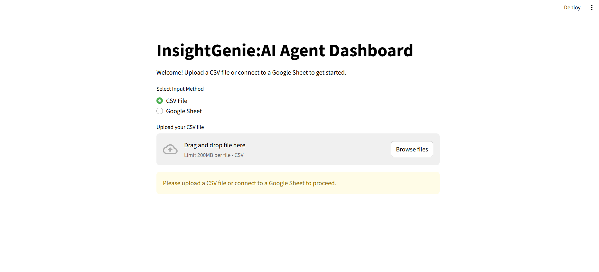

# InsightGenie

A **Streamlit research and data-extraction prototype** that combines CSV / Google Sheets input, targeted web search and FLAN-T5 text generation.



## What it does

- Reads a local CSV or a Google Sheet into a pandas DataFrame.
- Lets you select the entity column, a value column and a natural-language query template.
- Looks for the requested entity in the uploaded data; if not found, attempts a web search.
- Passes search snippets to `google/flan-t5-base` and displays the generated response.
- Exports extracted results to CSV.

The current implementation is **a single-entity query workflow**. It does not implement a general autonomous research agent or a verified large-scale batch pipeline.

## Source layout

```text
app.py                 Streamlit interface and query flow
utils/google_sheets.py  Google Sheets access
utils/google_search.py  Web-snippet retrieval
utils/llm_handler.py    FLAN-T5 inference
images/                Interface screenshots
requirements.txt
```

## Local setup

```bash
git clone https://github.com/DevyanshMalhotra/InsightGenie.git
cd InsightGenie
python -m venv .venv
# Windows: .venv\Scripts\activate
# Linux/macOS: source .venv/bin/activate
pip install -r requirements.txt
streamlit run app.py
```

Open the address shown by Streamlit. CSV mode works without Google credentials. For Sheets mode, configure access using `utils/google_sheets.py` and the Google Sheets API; do not commit credentials or service-account files. Hugging Face model files are downloaded on first use.

## Notes and limitations

- Google HTML search is scraped by selectors and may stop working if the search page changes or blocks requests.
- FLAN-T5 may produce incorrect or unsupported responses; verify extracted facts against original sources.
- The dataset and query parsing are prototype-level, not production ETL.
- User-provided URLs/data should be treated as untrusted input; deployment requires stronger validation, resource limits and secrets management.

[Demo walkthrough](https://www.loom.com/share/3207838274de4b3b883799c12e0fffec?sid=74a3f5e6-b204-4b47-9485-f211952998fd)
